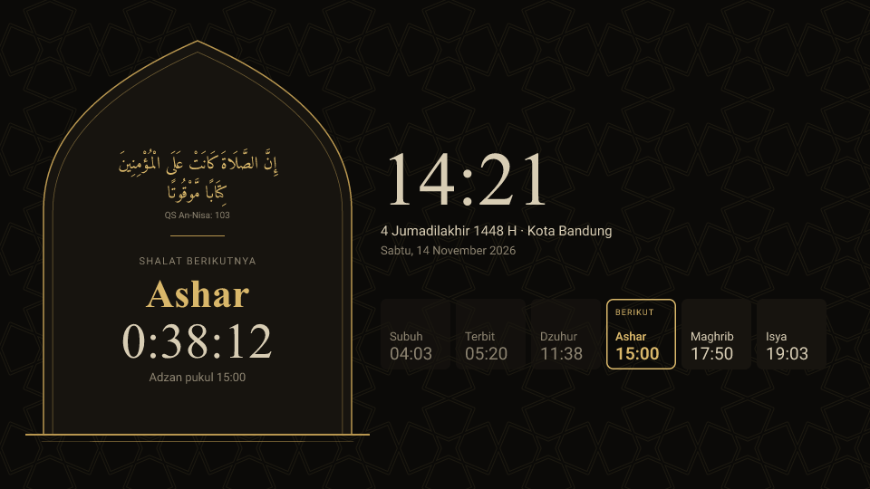
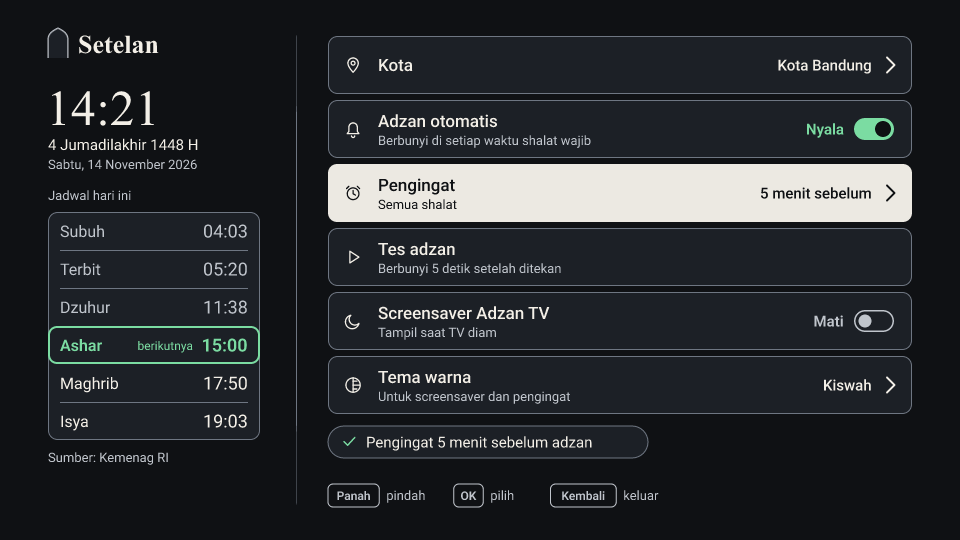
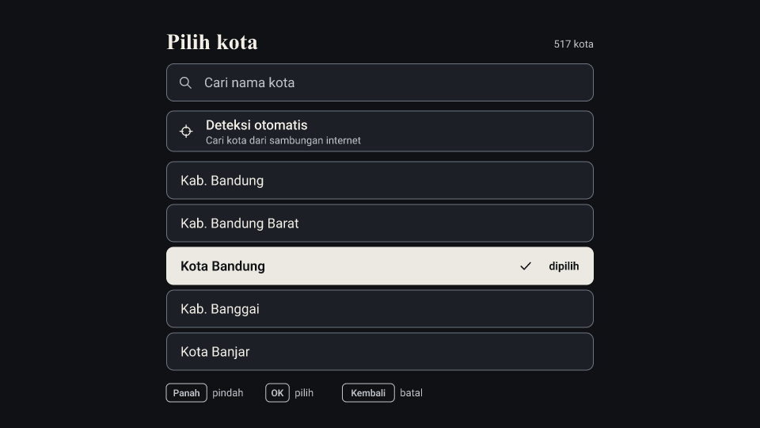
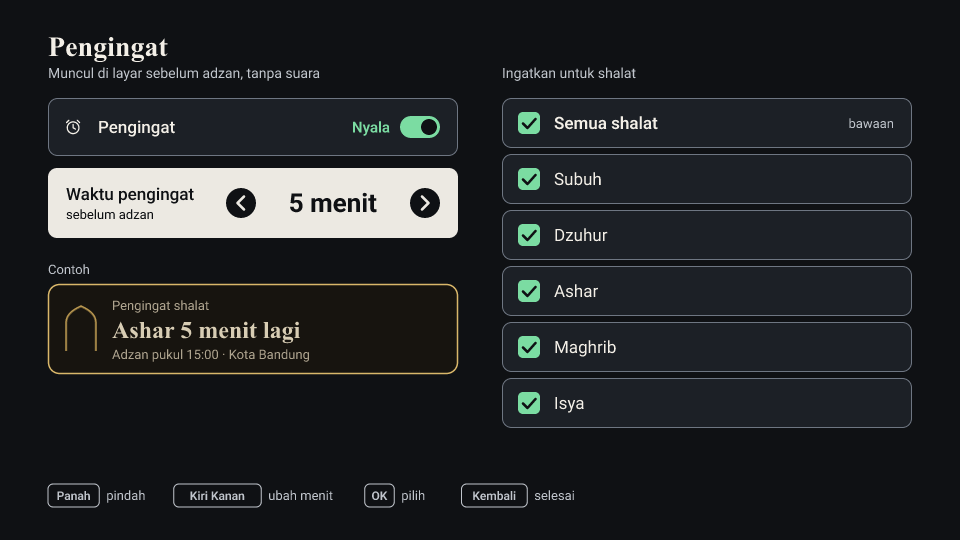
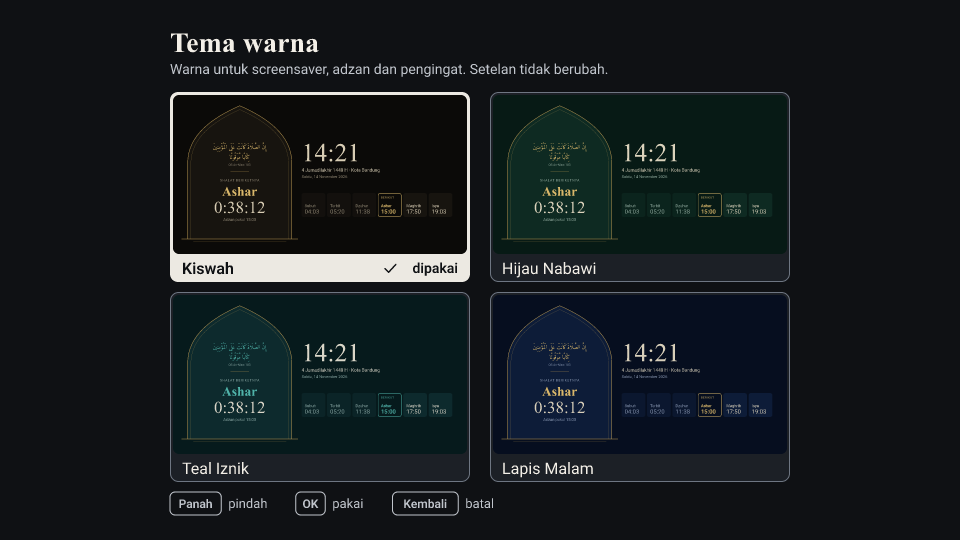

# Adzan TV

A Google TV screensaver that shows today's prayer times and plays the adhan at each prayer, using the official Kemenag (Bimas Islam) schedule for your kabupaten/kota. The Google TV home screen is not replaced.

- **Screensaver:** the clock, Gregorian and Hijri dates, Subuh–Isya and a countdown to the next prayer.
- **Adhan:** at each of the five prayers, a full-screen card appears over whatever is playing and the adhan plays. Press Back to stop it.
- **Location:** the city is guessed from your internet IP on first run. You can change it in the app (search or *Deteksi ulang*), and a city you pick is never overwritten.
- **Times:** the [myQuran API](https://api.myquran.com) (Kemenag data), cached per month. Without internet and without a cached schedule, the app calculates times on the TV with Kemenag parameters, marked *perkiraan*.

## Screens

| Screensaver | Adhan |
| --- | --- |
|  |  |
| **Reminder card** | **Settings** |
|  |  |
| **City** | **Reminder** |
|  |  |
| **Theme colours** | |
|  | |

Images are exported from the design file `docs/design/screens.figcraft`.

## Install on the TV (wireless debugging)

1. On the TV, go to Settings › System › About, then press OK on *Android TV OS build* 7 times. Then go to Settings › System › Developer options › **Wireless debugging** › on, and choose *Pair device with pairing code*.
2. On this computer:

   ```sh
   adb pair <tv-ip>:<pairing-port>        # enter the 6-digit code shown on the TV
   adb connect <tv-ip>:<debug-port>       # the port shown on the Wireless debugging screen
   tools/fetch-adhan.sh                   # the Makkah adhan; skip it to keep the CC0 one
   ./gradlew assembleDebug
   tools/backup.sh   <tv-ip>:<debug-port> # ALWAYS first: snapshots the settings the install changes
   tools/install.sh  <tv-ip>:<debug-port>
   ```

`install.sh` refuses to run unless a snapshot of that TV exists. Snapshots go in `backups/<tv-serial>/<timestamp>/`, which is git-ignored.

## Roll back

```sh
tools/restore.sh <tv-ip>:<debug-port>                      # newest snapshot
tools/restore.sh <tv-ip>:<debug-port> backups/<serial>/<ts> # a specific one
```

This uninstalls the app, which also removes its overlay permission, and puts every snapshot setting back. No other app is ever installed, disabled or removed.

## Develop

```sh
tools/fetch-adhan.sh          # optional: the Makkah adhan (unlicensed, git-ignored)
./gradlew testDebugUnitTest   # schedule, city matching, offline calc, alarms
./gradlew assembleDebug
```

In the app, *Tes adzan (1 menit)* fires the adhan one minute later, so you can check the card over another app or over the screensaver.

## Credits

- Adhan recording: "Athan Makkah" from [abodehq/Athan-MP3](https://github.com/abodehq/Athan-MP3), the Makkah voice in Afnon.
  That repo states no licence, so `tools/fetch-adhan.sh` downloads it and it is git-ignored, as Afnon does; run the script before building.
  Without it the app plays the bundled [*Beautiful adhan.ogg*](https://commons.wikimedia.org/wiki/File:Beautiful_adhan.ogg) by Adam-synagda, Wikimedia Commons, **CC0**.
- Arabic type: [Amiri](https://github.com/aliftype/amiri) by Khaled Hosny, SIL Open Font License 1.1 (`licenses/Amiri-OFL.txt`).
- Prayer times: Kemenag RI (Bimas Islam) via [myQuran API](https://api.myquran.com). Offline calculation: [adhan-java](https://github.com/batoulapps/adhan-java).
- IP location: [ipwho.is](https://ipwho.is). The TV's public IP is sent there on first run and on *Deteksi ulang*.
- Design inspired by [Afnon](https://github.com/egyjs/afnon-android-tv-launcher).
