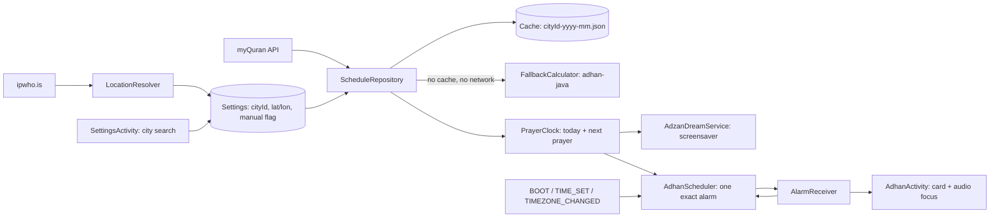
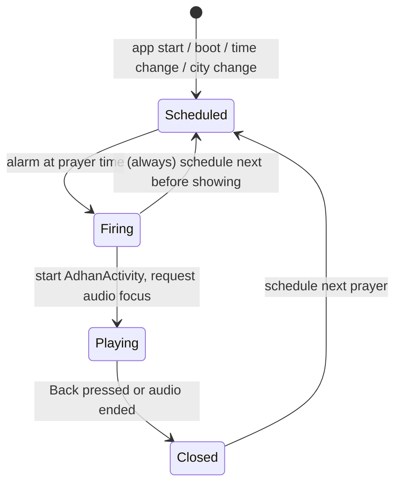

# Adzan Screensaver for Google TV - Plan

## Goal Capsule

- **Objective:** The household's Google TV keeps today's prayer times visible when it is idle and plays the adhan on time for the user's Indonesian city, using official Kemenag times. Every change made to the TV can be undone with one restore step.
- **Means:** A native Kotlin Android TV app (system screensaver plus exact-alarm adhan activity), installed over ADB wireless debugging by repo scripts that snapshot first (KTD1, KTD6).
- **Product authority:** The Product Contract below. For look and feel, the reference is Afnon (https://github.com/egyjs/afnon-android-tv-launcher), limited to its screensaver and call-to-prayer screens.
- **Stop conditions:**
  - Stop and ask the user if the TV ignores a third-party screensaver even when set over ADB (U8 device check), because R1 then needs a new product decision.
  - Never run the install step on the TV unless a snapshot from that same device exists (R14).
  - Never disable, uninstall or modify any app other than this one (R16).
- **Execution profile:** Build and unit-test locally. Touch the TV only in U8's device rollout, with the user present for the pairing code.
- **Who finishes:** `ce-work` builds U1–U8. The device rollout in U8 needs the user at the TV.
- **Open blockers:** None.

---

## Product Contract

Product Contract preservation: changed: R9, AE2. The manual picker is one searchable list of kabupaten/kota instead of province then city, because the myQuran city list has no province grouping. The user confirmed this at plan synthesis.

### Summary

A small Google TV app that adds a prayer-time system screensaver and an automatic full-screen adhan at each prayer. The stock launcher stays. Times come from the Kemenag schedule for a city guessed from the IP, and the user can override it. The app is installed over wireless debugging only after a settings snapshot and restore script exist.

### Problem Frame

The TV is the main screen in the home, but it knows nothing about the prayer day. Afnon solves this by replacing the whole launcher, which is more change than wanted here and harder to undo. Generic calculation methods can also drift from the times Indonesian mosques follow, which come from Kemenag (Bimas Islam). The user wants the prayer day on the TV without losing the familiar Google TV home, and with no risk of leaving the TV in a broken state.

### Key Decisions

- **Screensaver plus adhan, not a launcher replacement.** Keeps the Google TV home untouched and makes rollback trivial. Governs R1, R5, R6. (session-settled: user-directed — chosen over a full Afnon-style launcher and over a screensaver without adhan: smallest safe change that still calls the adhan)
- **Location by IP with manual override.** A TV has no GPS, and the ISP's location can land in a neighbouring city. Governs R8, R9. (session-settled: user-directed — chosen over IP-only and manual-only: automatic first run without being stuck on a wrong guess)
- **Kemenag schedule via the myQuran API, with offline calculation as a fallback.** The official schedule matches local mosques, and the fallback keeps the adhan working without internet. Governs R10, R11, R12. (session-settled: user-directed — chosen over online-only and offline-only)
- **Full-screen card over any app at prayer time.** The adhan must not be missed while watching. Governs R5, R6, R7. (session-settled: user-directed — chosen over a corner banner and over screensaver-only adhan)
- **Targeted settings snapshot plus a restore script, not a full device backup.** `adb backup` is deprecated and unreliable on Android 12+ Google TV, and the install only changes a few settings. Governs R14, R15, R16. (session-settled: user-directed — chosen over a full settings-table dump and over no backup)

### Requirements

**Screensaver**

- R1. The app is a system screensaver that Google TV starts after its normal idle timeout.
- R2. The screensaver shows the current time, the Gregorian and Hijri dates, today's six times (Subuh, Terbit, Dzuhur, Ashar, Maghrib, Isya), and a live countdown to the next prayer.
- R3. The screensaver's visual style follows Afnon's screensaver: dim background, slow drift to protect the panel from burn-in, and the next prayer emphasised.
- R4. Any remote key dismisses the screensaver, as with any system screensaver.

**Adhan at prayer time**

- R5. At each of the five obligatory prayer times, the app shows a full-screen card with the prayer name over whatever app is in the foreground. This applies even when the screensaver is not running.
- R6. The adhan plays with the card. Other media playback pauses through audio focus and may resume afterwards.
- R7. Pressing Back stops the adhan and closes the card. Otherwise the card closes when the adhan ends.

**Location**

- R8. On first run, the app estimates the user's city from the public IP and maps it to the matching Kemenag kabupaten/kota. When no city matches clearly, the app opens the picker (R9) instead of guessing.
- R9. A settings screen, usable with the D-pad, lets the user search and pick a kabupaten/kota from the Kemenag list, or re-run detection. A manual choice is not overwritten by later automatic detection.

**Prayer times source**

- R10. Times come from the Kemenag schedule for the selected kabupaten/kota, fetched from the myQuran API.
- R11. The schedule is cached on the TV for at least the current month, so daily operation does not need the network.
- R12. When neither a fresh nor a cached schedule is available, times are calculated on the TV with Kemenag parameters and the adhan still fires.
- R13. The adhan and the next-prayer countdown stay correct after a TV reboot, a time-zone change (WIB/WITA/WIT), or a new day.

**Safe install and rollback**

- R14. Before anything is installed or changed on the TV, the current values of every setting the install will touch are saved to a local folder in this repo. That covers the active screensaver component, screensaver enablement and timeout, and the permissions granted to the app. The installed-package list is saved too.
- R15. One restore script uninstalls the app and writes every saved setting back to its original value.
- R16. The install runs over ADB wireless debugging, pairing with the TV, and does not modify, disable or uninstall any existing app.

### Key Flows

- F1. First install
  - **Trigger:** The user enables wireless debugging on the TV and shares the pairing code.
  - **Steps:** Pair and connect over ADB; save the snapshot (R14); install the app; set it as the screensaver and grant what it needs to show over other apps (R1, R5); the app detects the city and fetches the schedule (R8, R10).
  - **Outcome:** The screensaver shows on the next idle, and the next prayer fires the adhan card.
  - **Covered by:** R1, R5, R8, R10, R14, R16
- F2. Prayer time arrives
  - **Trigger:** The clock reaches a prayer time from the active schedule.
  - **Steps:** The full-screen card appears over the current app, the adhan plays, and other media pauses (R5, R6). The user presses Back or lets the adhan finish (R7).
  - **Covered by:** R5, R6, R7
- F3. Rollback
  - **Trigger:** Something goes wrong, or the user wants the TV back as it was.
  - **Steps:** Run the restore script (R15).
  - **Outcome:** The app is gone and the screensaver settings match the snapshot.
  - **Covered by:** R15

### Acceptance Examples

- AE1. **Covers R5, R6, R7.** Given YouTube is playing at 12:01 and Dzuhur is 12:01, when the time arrives, YouTube pauses, the Dzuhur card covers the screen and the adhan plays. Pressing Back stops the adhan and returns to YouTube.
- AE2. **Covers R8, R9.** Given IP detection picked KOTA BEKASI but the user lives in Kota Bogor, when the user searches "bogor" in settings and picks KOTA BOGOR, the times switch to Bogor's, and later detection never switches them back.
- AE3. **Covers R11, R12.** Given the router is offline on the first day of a new month with no cached schedule for that month, when Ashar arrives, the adhan still fires at the locally calculated Kemenag time.
- AE4. **Covers R15.** Given the snapshot recorded the stock Google TV ambient screensaver with a 15-minute timeout, when the restore script runs, the app is uninstalled and the ambient screensaver and 15-minute timeout are active again.

### Scope Boundaries

Deferred for later:
- Reminders before prayer time, and announcements for prayers whose adhan is off.
- Raising the volume for the adhan when the TV is muted or at zero.
- More than one adhan voice. A separate Fajr adhan is included only if a freely licensed recording is easy to find.
- Turning the adhan on or off per prayer.

Outside this work's identity:
- Replacing the Google TV launcher or adding a home screen.
- Quran radio, Qibla direction, Friday and Ramadan modes, all-apps list.
- Debloating the TV or removing ads.

Considered and not built:
- Waking the TV from standby for the adhan. A TV in standby plays nothing. Revisit if the user reports missed adhans while the TV is "off".
- Next-month prefetch. On-demand fetch at the month boundary plus the U4 fallback cover it. Revisit if the 1st-of-month Subuh is ever seen on fallback times.
- Background periodic sync (WorkManager). The schedule is refreshed when an alarm fires, at boot, and when the screensaver starts, which is enough for a monthly cache. Revisit if the cache is ever found stale in practice.
- Automated UI or instrumented tests. The screensaver and overlay depend on the real Google TV, so they are checked on the device. Revisit if the UI grows beyond two screens.

### Dependencies / Assumptions

- **Must be verified on the real TV at rollout, before the final install (U8 step 4):** Google TV may hide third-party screensavers in its settings, so R1 is set over ADB. If this TV model ignores a third-party screensaver even when set over ADB, R1 needs a new decision.
- The myQuran API (`api.myquran.com/v2`) is reachable and keeps serving Kemenag schedules by kabupaten/kota. Verified 2026-10-31: 518 cities, monthly schedule for city 1301 (KOTA JAKARTA).
- IP geolocation sends the TV's public IP to a third-party service on first run and on re-detect.
- The UI language is Bahasa Indonesia. Asr follows the Shafi'i school, as Kemenag uses.
- The user is at the TV once to turn on wireless debugging and read out the pairing code.
- The adhan audio bundled with the app must be a recording that is free to redistribute.

### Sources / Research

- Afnon, reference for look and behaviour: https://github.com/egyjs/afnon-android-tv-launcher. Its backup-first approach came from https://github.com/Gathin23/cleanyourtv.
- myQuran API, probed 2026-10-31:
  - `GET /v2/sholat/kota/semua` returns `data[]` of `{id, lokasi}`, e.g. `{"id":"1222","lokasi":"KOTA BOGOR"}`. There are no coordinates and no province.
  - `GET /v2/sholat/kota/cari/{keyword}` returns the same shape filtered by name.
  - `GET /v2/sholat/jadwal/{id}/{yyyy}/{mm}` returns `data.lokasi`, `data.daerah` (province), and `data.jadwal[]` with `imsak, subuh, terbit, dhuha, dzuhur, ashar, maghrib, isya` as `HH:mm` strings and `date` as `yyyy-MM-dd`.
- ipwho.is (HTTPS, no key), probed 2026-10-31: returns `city` ("Jakarta"), `region` ("Java"), `latitude`, `longitude` and `timezone.id` ("Asia/Jakarta").
- adhan-java (`com.batoulapps.adhan:adhan`): offline prayer-time calculation with custom angles. Afnon uses it too.

---

## Planning Contract

### Key Technical Decisions

- KTD1. **Native Kotlin with Jetpack Compose, minSdk 28, targetSdk 35.** Compose is the current Android UI default. minSdk 28 covers every Google TV device. The TV's real API level is read in the U8 snapshot. (session-settled: user-approved — chosen over plain Views: proposed at plan synthesis, user confirmed)
- KTD2. **Platform networking and JSON, no HTTP library.** `HttpURLConnection` plus `org.json` handle three GET endpoints. Retrofit/OkHttp would add dependencies for no gain.
- KTD3. **The cache is one JSON file per city-month in app-private storage.** The raw myQuran `jadwal` response is stored as-is, keyed `<cityId>-<yyyy>-<mm>`. No database is needed, and the format is the API's own.
- KTD4. **Exact alarms that schedule one alarm at a time.** The app keeps one pending alarm, for the next prayer. When it fires, the app shows the adhan and schedules the next one. The same "reschedule next" runs on `BOOT_COMPLETED`, `TIME_SET`, `TIMEZONE_CHANGED`, app start, and city change. Uses `AlarmManager.setAlarmClock`, which is exempt from Doze. Governs R5, R13.
- KTD5. **The adhan card starts as an Activity, allowed by the overlay permission.** Android 10+ blocks background activity starts unless the app holds `SYSTEM_ALERT_WINDOW`. The install script grants it with `appops`, because Google TV has no UI to grant it. Governs R5.
- KTD6. **The screensaver is set over ADB, not through the TV's settings UI.** `settings put secure screensaver_components <pkg>/<DreamService>` plus `screensaver_enabled 1`. Google TV hides third-party screensavers in its picker. Governs R1, R14.
- KTD7. **City matching normalises names, then needs exactly one candidate.** The IP city is upper-cased and stripped of "KOTA"/"KAB."/"KABUPATEN". If the input contained "KAB." or "KABUPATEN", only `KAB.` entries are considered. Otherwise the `KOTA` entry wins when both `KOTA X` and `KAB. X` exist. It counts as a match only when exactly one Kemenag `lokasi` is left. Otherwise the picker opens (R8). shortcut: name matching only, no coordinates, so a city the IP service spells differently falls to the picker. Upgrade by bundling kabupaten/kota centroids if users hit the picker often.
- KTD8. **The offline fallback uses adhan-java with Kemenag parameters.** Fajr 20°, Isha 18°, Shafi'i Asr, and a +2 minute ihtiyat on each time, at the latitude/longitude saved from the last IP lookup (stored even when the user later picks a city manually). Governs R12.
- KTD9. **Device scripts are plain bash in `tools/` and snapshot under git-ignored `backups/<device-serial>/<timestamp>/`.** `<device-serial>` is `getprop ro.serialno`, because the wireless `ip:port` changes on every re-pair and is used only as the `adb -s` target. One folder per run. `restore.sh` uses the newest folder unless one is given as an argument. Governs R14, R15.

### High-Level Technical Design

Component shape:



Adhan alarm lifecycle (directional):



Device rollout order (U8): pair and connect, snapshot, install the APK, screensaver stop-condition check, the rest of `install.sh`, a restore round-trip, re-install, then verify. Restore is: uninstall, then write back the snapshot values.

### Output Structure

```text
settings.gradle.kts
build.gradle.kts
gradle/ (wrapper, libs.versions.toml)
app/
  build.gradle.kts
  src/main/AndroidManifest.xml
  src/main/res/raw/adhan.(ogg|mp3)
  src/main/java/<pkg>/
    data/   ScheduleRepository, MyQuranClient, LocationResolver, CityMatcher, FallbackCalculator, Prefs
    time/   PrayerClock, PrayerTimes model
    adhan/  AdhanScheduler, AlarmReceiver, BootReceiver, AdhanActivity
    dream/  AdzanDreamService, ScreensaverContent (Compose)
    settings/ SettingsActivity
  src/test/java/<pkg>/ ...
  src/test/resources/ (recorded myQuran JSON fixtures)
tools/
  backup.sh
  restore.sh
  install.sh
backups/            (git-ignored)
README.md
```

### Assumptions

- Package name `id.adzantv` unless the user prefers another (cosmetic, changeable before first install).
- Gradle wrapper and the project skeleton are created with the installed `android` CLI or Android Studio Panda templates. No global Gradle is installed, and JDK 21 is present.
- The adhan recording comes from Wikimedia Commons under a public-domain or CC licence, credited in `README.md`.

---

## Implementation Units

### U1. Android TV project scaffold

**Goal:** A buildable, installable Android TV app shell with a launcher entry that opens settings.
**Requirements:** KTD1. Foundation for R1, R5, R9.
**Dependencies:** None.
**Files:** `settings.gradle.kts`, `build.gradle.kts`, `gradle/libs.versions.toml`, `gradle/wrapper/*`, `gradlew`, `app/build.gradle.kts`, `app/src/main/AndroidManifest.xml`, `.gitignore` (adds `backups/`, `build/`, `local.properties`).
**Approach:**
1. Create a single-module Compose project. Use `android-cli` (skill) or Studio templates rather than hand-writing the Gradle setup.
2. Manifest:
   - declares `android.software.leanback` (required false) and touchscreen not required
   - gives `SettingsActivity` a `LEANBACK_LAUNCHER` intent filter and a banner
   - requests `INTERNET`, `RECEIVE_BOOT_COMPLETED`, `SCHEDULE_EXACT_ALARM`, `SYSTEM_ALERT_WINDOW`
3. Add adhan-java (verify the current version on Maven Central).
**Execution note:** Packaging/config. Prove it with `assembleDebug` succeeding, not unit tests.
**Test expectation:** none -- scaffold only.
**Verification:** `./gradlew assembleDebug` produces an APK. `.gitignore` excludes `backups/`.

### U2. Kemenag schedule: fetch, cache, next prayer

**Goal:** Given a city ID and "now", the app knows today's six times and the next obligatory prayer, from cache when possible.
**Requirements:** R2 (data), R10, R11, R13. KTD2, KTD3.
**Dependencies:** U1.
**Files:** `app/src/main/java/<pkg>/data/MyQuranClient.kt`, `data/ScheduleRepository.kt`, `time/PrayerTimes.kt`, `time/PrayerClock.kt`; tests `app/src/test/java/<pkg>/time/PrayerClockTest.kt`, `app/src/test/java/<pkg>/data/ScheduleRepositoryTest.kt`; fixture `app/src/test/resources/jadwal-1301-2026-10.json` (recorded from the API).
**Approach:**
- `ScheduleRepository.today(cityId, date)` reads the cache for the date's month, otherwise fetches and writes the cache, otherwise delegates to the fallback (U4 contract: same `PrayerTimes` shape).
- `PrayerClock` is pure: given `PrayerTimes` for today and tomorrow plus a `ZonedDateTime`, it returns the next obligatory prayer (Terbit excluded) and its instant.
- Times are interpreted in the device's current zone, matching how Kemenag publishes local time.
**Test scenarios:**
- Parsing the recorded fixture yields 31 days, and 2026-10-01 has Subuh 04:23 and Isya 18:59.
- At 12:00 with Dzuhur 11:46 and Ashar 14:51, the next prayer is Ashar at 14:51.
- After Isya (21:00), the next prayer is tomorrow's Subuh.
- At exactly the prayer minute (11:46:00), that prayer counts as now, so the next prayer is the following one. This guards against double-firing.
- Terbit is never returned as the next obligatory prayer.
- On Oct 31 after Isya, the next prayer is Nov 1 Subuh, fetched on demand for November (fake client).
- Cache hit: a second `today()` call makes no network request (fake client counts calls).
- Network error with no cache delegates to the fallback and does not throw.
- A malformed JSON response is treated as a network error and does not overwrite a good cache.
**Verification:** Unit tests pass. The fixture comes from the real API.

### U3. Location: IP detection, city matching, manual override

**Goal:** The app knows which Kemenag city to use. It is detected once, can be overridden by the user, and a manual choice is never overwritten.
**Requirements:** R8, R9 (data side), AE2. KTD7.
**Dependencies:** U1, U2 (shares `MyQuranClient` for the city list).
**Files:** `data/LocationResolver.kt`, `data/CityMatcher.kt`, `data/Prefs.kt`; tests `app/src/test/java/<pkg>/data/CityMatcherTest.kt`, `app/src/test/java/<pkg>/data/LocationResolverTest.kt`; fixture `app/src/test/resources/kota-semua.json`.
**Approach:**
- `Prefs` stores `cityId`, `cityName`, `lat`, `lon`, and `manual: Boolean`.
- `LocationResolver.detect()` calls ipwho.is.
  - It always saves `lat`/`lon` for the fallback (KTD8).
  - It writes the city only when `manual` is false and `CityMatcher` returns exactly one match.
  - It returns "needs picker" otherwise.
- A manual pick sets `manual = true`. "Re-detect" ignores `manual` for that one call, and clears it only when detection returns a unique match. On failure, the manual choice stays.
- The `kota/semua` city list is cached in app-private storage like the schedule (KTD3), so the picker works offline after the first successful fetch.
**Test scenarios:**
- "Jakarta" matches KOTA JAKARTA (1301).
- "Bogor" matches KOTA BOGOR (1222) over KAB. BOGOR (1204).
- "Kabupaten Bandung" matches KAB. BANDUNG.
- A city absent from the list (e.g. "Singapore", or a non-ID country code) returns "needs picker".
- Covers AE2: with `manual = true` and cityId 1222, detect() returning Bekasi leaves cityId at 1222.
- Re-detect that fails or finds no unique match keeps the manual city and `manual = true`.
- An IP service failure leaves the existing city untouched and reports "needs picker" only when no city is stored.
**Verification:** Unit tests pass against the recorded city list.

### U4. Offline Kemenag calculation fallback

**Goal:** Prayer times are always available, even with no network and no cache.
**Requirements:** R12, AE3. KTD8.
**Dependencies:** U2 (the `PrayerTimes` shape), U3 (stored lat/lon).
**Files:** `data/FallbackCalculator.kt`; test `app/src/test/java/<pkg>/data/FallbackCalculatorTest.kt`.
**Approach:** Wrap adhan-java with custom parameters (KTD8) and map the result to `PrayerTimes`. With no stored lat/lon at all, use Jakarta (-6.2, 106.85) and the device time zone. shortcut: Jakarta default only happens before any successful IP lookup, so upgrade if offline first boot ever matters.
**Test scenarios:**
- For Jakarta (-6.2146, 106.8451) on 2026-10-01, each of Subuh, Dzuhur, Ashar, Maghrib and Isya is within 2 minutes of the fixture's Kemenag times (04:23, 11:46, 14:51, 17:50, 18:59).
- The same check passes on 2026-10-31 from the same fixture.
- Covers AE3: with no lat/lon stored, the calculator still returns six times.
**Verification:** Tests pass. If the 2-minute bound fails, tune the ihtiyat in one place and record the result in KTD8.

### U5. Adhan trigger: alarm, receivers, full-screen card

**Goal:** At each prayer a full-screen card appears over any app and the adhan plays, surviving reboot and time changes.
**Requirements:** R5, R6, R7, R13, F2, AE1. KTD4, KTD5.
**Dependencies:** U2.
**Files:** `adhan/AdhanScheduler.kt`, `adhan/AlarmReceiver.kt`, `adhan/BootReceiver.kt`, `adhan/AdhanActivity.kt`, `app/src/main/res/raw/adhan.*`, manifest entries; test `app/src/test/java/<pkg>/adhan/AdhanSchedulerTest.kt`.
**Approach:**
1. `AdhanScheduler.scheduleNext(now)` asks `PrayerClock` for the next prayer. It sets one `setAlarmClock` alarm whose PendingIntent carries the prayer name, replacing any previous alarm.
2. `AlarmReceiver` calls `scheduleNext` first, then starts `AdhanActivity`. It skips the start if the alarm is more than 5 minutes late, e.g. delivered after a long standby.
3. `BootReceiver` listens for `BOOT_COMPLETED`, `TIME_SET` and `TIMEZONE_CHANGED`, and calls `scheduleNext`.
4. `AdhanActivity` is full-screen and takes over from a running screensaver. It shows the prayer name, time and city, with the hint "Tekan Kembali untuk menghentikan". If audio fails to start, the card still shows and closes after 60 seconds. It plays with `MediaPlayer` and `AUDIOFOCUS_GAIN_TRANSIENT`, which pauses other media. On Back, or on completion, it releases the player, abandons focus and finishes.
**Test scenarios:**
- `scheduleNext` at 12:00 (Ashar 14:51) requests one alarm at 14:51 today with extra "Ashar" (fake AlarmManager wrapper).
- `scheduleNext` called twice replaces the earlier alarm rather than adding a second.
- After a time-zone change from WIB to WITA, `scheduleNext` recomputes the instant in the new zone.
- An alarm delivered 6 minutes late is skipped, but the next one is still scheduled.
- Covers AE1 (device, manual): YouTube pauses, the card shows, Back stops the audio and YouTube is back.
- Device, manual: with the screensaver running, the test broadcast shows the card and the adhan is audible.
**Verification:** Unit tests pass. On the TV, `adb shell dumpsys alarm` shows exactly one pending alarm for the package. A test broadcast to `AlarmReceiver` shows the card over another app.

### U6. Screensaver (DreamService)

**Goal:** When the TV goes idle, an Afnon-like dim screen shows the clock, the dates, today's times and a countdown.
**Requirements:** R1, R2, R3, R4. KTD1, KTD6.
**Dependencies:** U2.
**Files:** `dream/AdzanDreamService.kt`, `dream/ScreensaverContent.kt`, manifest `<service>` with `android.service.dreams.DreamService` filter and `BIND_DREAM_SERVICE` permission.
**Approach:**
- Host a `ComposeView` inside the `DreamService`. A DreamService is not a `LifecycleOwner`, so wire `ViewTreeLifecycleOwner` and `SavedStateRegistryOwner` by hand. This is the known gotcha.
- Set `isInteractive = false` so any key dismisses it (R4), and `isFullscreen = true`.
- Content: the city name, with a small "perkiraan" marker when today's times come from the offline fallback ("Atur kota di aplikasi Adzan" instead of times when no city is stored); a large clock; the Gregorian date plus the Hijri date via `android.icu.util.IslamicCalendar` (no dependency); the six times with the next one emphasised; a countdown ticking once a second; a slow position drift every minute for burn-in.
- The Hijri date uses `IslamicCalendar` in its civil (tabular) variant. It may differ by a day from Indonesian sighting, which is an accepted limit with no offset setting in scope.
- On start, also call `AdhanScheduler.scheduleNext` as a cheap self-heal.
**Test expectation:** none -- rendering only. `PrayerClock` (U2) carries the logic.
**Verification:** On the TV, `adb shell am start -n com.android.systemui/.Somnambulator` or idle timeout shows the screensaver. Any remote key dismisses it. Take a screenshot for the user.

### U7. Settings screen: city search and re-detect

**Goal:** With the D-pad, the user can see the current city, search and pick another, or re-run detection.
**Requirements:** R8 (picker fallback), R9, AE2.
**Dependencies:** U3.
**Files:** `settings/SettingsActivity.kt`.
**Approach:**
- One Compose screen showing the current city and today's times (proves the data path), a search field filtering the 518 cached Kemenag cities, a focusable list, and a "Deteksi ulang" button.
- First launch with "needs picker" opens directly on search.
- States: loading; "Tidak ada koneksi, coba lagi" with a focusable retry button when no city list is cached; "Kota tidak ditemukan" for an empty search; "Deteksi ulang" shows progress, then "Kota diubah ke X" or "Kota tidak terdeteksi, pilih manual" with focus moved to search.
- Picking a city saves it (manual = true), fetches its month, and calls `scheduleNext`.
**Test expectation:** none -- thin UI over U3, whose tests cover the override rule.
**Verification:** On the TV, the D-pad can reach every control. Picking KOTA BOGOR changes the times shown and the next alarm.

### U8. Backup, restore, install scripts and device rollout

**Goal:** The app reaches the TV over wireless debugging only after a snapshot exists, and one command undoes everything.
**Requirements:** R14, R15, R16, F1, F3, AE4. KTD6, KTD9.
**Dependencies:** U1–U7 for rollout. The scripts themselves depend on nothing.
**Files:** `tools/backup.sh`, `tools/restore.sh`, `tools/install.sh`, `README.md` (usage, rollback, adhan audio credit).
**Approach:**
- All scripts take the device as `ip:port` and use `adb -s` on every call. They use `set -euo pipefail` and print each setting they change.
- `backup.sh` saves into `backups/<serial>/<timestamp>/`:
  - `getprop` model, SDK and build fingerprint
  - `pm list packages`
  - the `settings get` value for `secure screensaver_enabled`, `screensaver_components`, `screensaver_default_component`, `screensaver_activate_on_sleep`, `screensaver_activate_on_dock`, `system screen_off_timeout`, `secure sleep_timeout`
  - The script records "null" explicitly, because a missing key must be restored with `settings delete`.
- `install.sh`:
  1. refuses to run unless a snapshot for this serial exists
  2. installs the APK with `adb install -r`, never `-d` and never touching other packages
  3. sets `screensaver_components` and `screensaver_enabled` (KTD6)
  4. grants `appops SYSTEM_ALERT_WINDOW allow` and `SCHEDULE_EXACT_ALARM allow` (KTD5)
  5. reads each value back and fails loudly if it did not stick
  6. starts `SettingsActivity` with `am start`. A freshly installed app stays in the stopped state, getting no `BOOT_COMPLETED`, until something launches it. First launch detects the city and schedules the first alarm.
- Before install, the app holds no grants, and the snapshot's package list records that it is absent. Uninstall clears the appops grants, so restore needs no permission write-back (R14).
- `install.sh --apk-only` runs step 2 alone, for the stop-condition check.
- `restore.sh` uninstalls the package if it is present. It then writes back every snapshot value (`put`, or `delete` for null) and reads them back to confirm.
- Rollout order on the device, with the user present:
  1. `adb pair` with the user's code, then `adb connect`.
  2. `backup.sh`.
  3. `install.sh --apk-only`.
  4. Stop condition check: set the screensaver to our component, trigger it, and confirm it shows. If it doesn't, run `restore.sh` and stop to ask the user.
  5. `install.sh` (full).
  6. `restore.sh`, then confirm the AE4 values match the snapshot.
  7. `install.sh` (full) again.
  8. Verify: the city is resolved (or picked with the user), `dumpsys alarm` shows one pending alarm, the screensaver shows, and a test broadcast shows the adhan over another app and over the screensaver.
**Execution note:** Prove with `bash -n` and a dry run against the real TV's backup first. Restore is exercised once on the device right after the first install, then re-install. This proves AE4 before the user relies on it.
**Test scenarios:**
- `install.sh` with no snapshot for the serial exits non-zero and changes nothing.
- Covers AE4: backup → install → restore leaves every recorded key equal to its snapshot value, and the package is absent from `pm list packages`.
- A key that was null in the snapshot is deleted on restore, not set to the string "null".
- The `pm list packages` count is unchanged except for this app after install, and identical after restore.
**Verification:** The AE4 round-trip passes on the real TV, and a final install leaves the screensaver active.

---

## Verification Contract

- `./gradlew testDebugUnitTest`: U2, U3, U4 and U5 unit tests pass.
- `./gradlew assembleDebug`: the APK builds with no lint errors that block the build.
- `bash -n tools/*.sh`: the scripts parse. Run `shellcheck` too if installed (it is not currently installed).
- On-device checks, in U8's rollout order:
  - the AE4 round-trip
  - the screensaver shows and dismisses (U6)
  - the adhan card over another app, and over the running screensaver, via a test broadcast (U5, AE1)
  - the city picker (U7, AE2)
  - a screenshot of the screensaver and the adhan card sent to the user

## Definition of Done

- Every R1–R16 is met, as shown by the unit tests above or the on-device checks in the Verification Contract.
- A snapshot of the user's TV exists in `backups/`, and `restore.sh` was proven on that TV (AE4) before the final install.
- The final state on the TV: the app is installed and set as the screensaver, one adhan alarm is pending, and no other package has changed.
- `README.md` documents install, rollback, and the adhan audio's licence and source.
- No experimental or abandoned code is left in the diff, and `backups/` is not committed.
