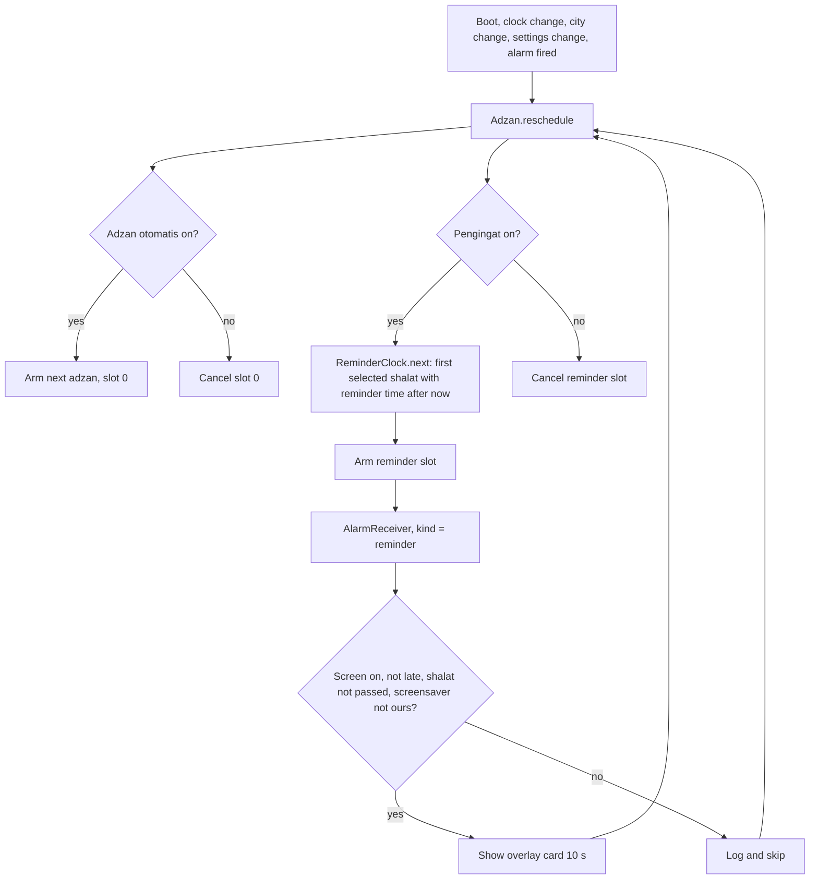

# Neutral Large-Type Settings and Prayer Reminder - Plan

## Goal Capsule

- **Objective:** An elderly viewer can read and operate every settings screen from the sofa, and the household is told a few minutes before each adzan without the TV programme being interrupted.
- **Means:** Rebuild the Compose settings screens to the FigCraft frames `11-setelan-statis` to `14-tema-warna-statis` in `docs/design/screens.figcraft`, and add a reminder that runs on its own alarm and shows as an overlay card.
- **Product authority:** The Product Contract below. For layout, sizes and colours the reference is `docs/design/screens.py` (functions `static_palette`, `big_settings`, `big_city`, `big_reminder`, `big_theme`), which generated those frames.
- **Stop conditions:**
  - Stop and ask the user if the overlay card cannot be shown over another app on the real TV (U5 device check). The fallback changes what the user sees, so it is their decision.
  - Do not change how the adzan alarm is scheduled or played. The reminder is added beside it.
- **Execution profile:** Build and unit-test locally. Device checks need the user's TV or an Android TV emulator; none was connected during planning.
- **Who finishes:** `ce-work` builds U1 to U6. The on-device checks in the Verification Contract need the user at the TV.
- **Open blockers:** None.

---

## Product Contract

### Summary

The settings screens stop following the colour theme and use one fixed neutral palette with large type. A new reminder shows a small card a chosen number of minutes before adzan, for all shalat or only the ones the user picks. The theme continues to colour the screensaver, the adzan screen and the reminder card.

### Problem Frame

The settings screens in the app use the earlier themed design. A colour audit found that row edges and dividers are close to invisible (1.08 to 1.34 contrast), hint text sits below the comfortable 7:1 level, several labels are 18 to 22sp, and one accent colour carries five meanings. For an elderly viewer across a room this is hard to read and to operate with a remote.

Separately, the app only speaks at adzan time. Someone watching TV gets no warning to finish what they are doing and prepare for shalat.

### Key Decisions

- **Settings use one fixed neutral palette.** Only the screensaver, adzan screen and reminder card follow the chosen theme. (session-settled: user-directed — chosen over theme-following settings: settings must read the same whatever theme is picked.) Governs R1, R2.
- **The focused row is a plain light fill with dark text.** (session-settled: user-directed — chosen over an amber fill: amber stood out too much and was not neutral.) Governs R3.
- **Green is the only colour in settings and means "on, chosen or next".** Every such state also carries a word or a mark. Governs R4.
- **The reminder is silent, shows for 10 seconds, defaults to on at 5 minutes, and does not pause what is playing.** (session-settled: user-approved — the user confirmed these defaults at scope confirmation.) Governs R9, R12, R13.
- **The reminder has its own switch and still appears when "Adzan otomatis" is off.** (session-settled: user-approved — confirmed at scope confirmation.) Governs R11.
- **"Deteksi ulang" lives in the Pilih kota screen, not on Setelan.** (session-settled: user-approved — confirmed at scope confirmation.) Governs R6.

### Requirements

**Look and readability**
- R1. Setelan, Pilih kota, Pengingat and Tema warna use the fixed palette: background `#0F1114`, row fill `#1C2026`, row outline `#6E7682`, main text `#F3EFE7`, secondary text `#C0C5CC`, focus fill `#ECE9E2`, state green `#7BDCA2`. Changing the theme does not change these screens.
- R2. The screensaver, the adzan screen and the reminder card keep using the chosen theme.
- R3. The focused item is a light fill with dark text and no outer ring. Exactly one item is focused at a time.
- R4. Green appears only for: a switch that is on, a checked box, the next prayer, and the success mark in the status line. Each is paired with a word ("Nyala", "Mati", "dipilih", "dipakai", "berikutnya") or a check mark.
- R5. No text on these screens is smaller than 26sp. Row labels are 34sp, values 30sp, schedule names 32sp and times 36sp. Every row has a visible 2dp outline.

**Setelan**
- R6. Setelan shows six rows without group headings: Kota, Adzan otomatis, Pengingat, Tes adzan, Screensaver Adzan TV, Tema warna. "Deteksi otomatis" is the first item in Pilih kota.
- R7. The sidebar shows the current time, the Hijri date and the Gregorian date above today's schedule. The time updates without user action.
- R8. Remote hints are words in key caps ("Panah pindah", "OK pilih", "Kembali keluar"), and the status message appears in one fixed pill under the rows.

**Reminder**
- R9. The reminder can be switched on or off. It is on by default.
- R10. The lead time is a whole number of minutes from 1 to 10, default 5, changed with Left and Right on one stepper row.
- R11. The reminder applies to all five obligatory shalat by default, or only to the ones the user checks. Terbit is never offered. It does not depend on "Adzan otomatis".
- R12. At the lead time before a selected shalat, a card appears at the top right over whatever is on screen, reading "<Shalat> <N> menit lagi" with the adzan time and city. It makes no sound and does not pause playback or take remote focus.
- R13. The card disappears by itself after 10 seconds.
- R14. No reminder is shown when the TV is in standby, when it would be delivered more than one minute late, when the shalat time has already passed, or while the Adzan TV screensaver is on screen (it already shows the countdown to the next shalat).
- R15. The Pengingat screen shows a sample of the card in the current theme.
- R16. The user cannot end up with the reminder on and no shalat selected.

### Key Flows

- F1. Set a reminder
  - **Trigger:** OK on the Pengingat row in Setelan.
  - **Steps:** The Pengingat screen opens with focus on the switch. Down moves to the stepper; Left and Right change the minutes. Right or Down reaches the shalat list; OK toggles a box. Kembali returns to Setelan.
  - **Outcome:** The Pengingat row reads the new lead time and "Semua shalat" or "<n> dari 5 shalat". The next reminder is re-armed at once.
  - **Covered by:** R9, R10, R11, R16
- F2. Reminder appears
  - **Trigger:** The reminder alarm fires.
  - **Steps:** The card slides in at the top right, stays 10 seconds, and leaves. The next reminder is armed.
  - **Outcome:** The viewer has been told; the programme never stopped.
  - **Covered by:** R12, R13, R14

### Acceptance Examples

- AE1. **Covers R10, R12.** Given Ashar at 15:00 and a 5 minute lead, when the clock reaches 14:55, then the card reads "Ashar 5 menit lagi" and "Adzan pukul 15:00 · Kota Bandung".
- AE2. **Covers R11.** Given only Subuh, Maghrib and Isya are checked, when Dzuhur and Ashar approach, then no card appears; before Maghrib one does.
- AE3. **Covers R14.** Given it is 14:57 with a 5 minute lead and Ashar at 15:00, when the reminder is (re)armed, then the next reminder is for Maghrib, not a late one for Ashar.
- AE4. **Covers R1, R2.** Given the theme is changed from Kiswah to Teal Iznik, then Setelan looks identical and the screensaver, adzan screen and reminder sample are teal.
- AE5. **Covers R16.** Given only Isya is checked, when the user presses OK on Isya, then it stays checked and the status line says to keep at least one shalat.

### Scope Boundaries

- The launcher icon and banner are not changed.
- The screensaver and adzan screens are not redesigned.
- No reminder sound, no snooze, no per-shalat lead times.
- No "Teks besar" option: large type is the only settings layout.

### Dependencies / Assumptions

- The app already declares `SYSTEM_ALERT_WINDOW` and `tools/install.sh` grants it with `appops`, so the overlay needs no new install step. A TV installed without that script will not show the card; R12 then fails quietly and the log says why.
- The Hijri date uses the same civil calculation as the screensaver and can differ by a day from moon sighting.

### Sources / Research

- Design frames and their generator: `docs/design/screens.figcraft`, `docs/design/screens.py`.
- Existing scheduling pattern: `app/src/main/java/id/adzantv/adhan/AdhanScheduler.kt` (alarm slots), `app/src/main/java/id/adzantv/Adzan.kt` (`reschedule`), `app/src/main/java/id/adzantv/adhan/AlarmReceiver.kt`.
- Existing pure-logic test pattern: `app/src/test/java/id/adzantv/time/PrayerClockTest.kt`, `app/src/test/java/id/adzantv/adhan/AdhanSchedulerTest.kt`.
- No `docs/solutions/` entries and no external research: the alarm, receiver and overlay permission patterns already exist in this repo.

---

## Planning Contract

### Key Technical Decisions

- KTD1. **Settings colours are fixed constants, separate from `Palette`.** A small `SettingsColors` object in `ui/` holds the R1 values. Settings composables stop reading `Ground`, `Surface`, `Gold`, `Ivory`, `Mist`. This keeps `LocalPalette` untouched for the themed screens and makes it impossible for a theme to leak into settings. The Material colour scheme used by the search field is built from the same constants.
- KTD2. **The reminder is a second alarm chain in its own slot.** `AdhanScheduler` already keys pending alarms by slot (0 real, 1 test). The reminder uses a new slot and an extra that marks the alarm as a reminder. One pending reminder at a time, re-armed after it fires, exactly like the adzan chain. A single combined alarm was rejected: the adzan chain is cancelled when "Adzan otomatis" is off, which would break R11.
- KTD3. **Which reminder is next is a pure function.** Given today's and tomorrow's times, now, the lead minutes and the selected shalat, it returns the first selected obligatory shalat whose reminder instant is strictly after now. This is where AE2 and AE3 are decided, so it is unit-tested without Android.
- KTD4. **The card is an overlay window, not an Activity.** An Activity would take focus and pause most players, breaking R12. The overlay is added by the receiver with "not focusable, not touchable" flags and removed by a main-thread timer after 10 seconds. It hosts the Compose card, which needs a minimal lifecycle and saved-state owner attached to the view.
- KTD5. **While our own screensaver is showing, no card is drawn.** The screensaver already shows the next shalat, a live countdown and a brighter arch in the last 10 minutes. Whether an overlay even draws above a dream is device-dependent, so skipping avoids a path that cannot be tested off-device.
- KTD6. **Reminder choices live in `Prefs`.** Three keys: on (default true), minutes (default 5, clamped to 1..10 on read), and the selected shalat as a string set where "absent" means all five. Storing "all" as absent keeps the default correct for existing installs.
- KTD7. **`Adzan.reschedule` arms both chains.** Every existing caller (boot, clock change, city change, alarm fired, settings toggles) then keeps the reminder correct with no new call sites. The adzan branch keeps its early exit behaviour for "Adzan otomatis" off, but the reminder branch runs regardless.
- KTD8. **`SettingsActivity.kt` is split by screen.** It is about 700 lines and gains a fourth screen. Shared pieces (row, switch, icon, hints, status, focus box) move to one file; each screen gets its own. The Activity keeps state and actions.

### High-Level Technical Design

Directional sketch of the two alarm chains, not an implementation specification.



### Output Structure

```text
app/src/main/java/id/adzantv/
  ui/SettingsColors.kt            new: fixed palette (KTD1)
  ui/ReminderCard.kt              new: themed card, used by overlay and sample
  time/ReminderClock.kt           new: pure next-reminder logic (KTD3)
  adhan/ReminderOverlay.kt        new: overlay window host (KTD4)
  settings/SettingsActivity.kt    state and actions only
  settings/SettingsParts.kt       new: row, switch, icon, hints, status, focus box
  settings/SettingsScreen.kt      new: Setelan
  settings/CityScreen.kt          new: Pilih kota
  settings/ReminderScreen.kt      new: Pengingat
  settings/ThemeScreen.kt         new: Tema warna
```

### Assumptions

- Type sizes in the frames are stage units on the existing 1920x1080 `Stage`, so they map one to one to the `sp`/`dp` values already used in this code.
- A process that owns a visible overlay window is not killed within the 10 seconds after the broadcast returns. If the device check shows otherwise, hold the broadcast open with `goAsync` for the display time.
- Roboto stands in for the device's default sans in the frames; the app keeps the system default font.

---

## Implementation Units

### U1. Reminder data and next-reminder logic

**Goal:** The app can store reminder choices and compute which reminder comes next.
**Requirements:** R9, R10, R11, R14, R16. KTD3, KTD6.
**Dependencies:** None.
**Files:** `app/src/main/java/id/adzantv/data/Prefs.kt`, `app/src/main/java/id/adzantv/time/ReminderClock.kt`; test `app/src/test/java/id/adzantv/time/ReminderClockTest.kt`.
**Approach:**
- Add the three `Prefs` keys from KTD6. Reading minutes clamps to 1..10. Reading the shalat set drops unknown names and Terbit.
- `ReminderClock.next` mirrors `PrayerClock.next`: it walks today's then tomorrow's obligatory shalat, keeps the selected ones, and returns the first whose reminder instant is strictly after now, with both the reminder instant and the shalat instant.
- A small pure helper decides the result of toggling a box (all, one, last remaining) so R16 is testable.
**Test scenarios:**
- 14:00, Ashar 15:00, lead 5, all selected: reminder at 14:55 for Ashar.
- 14:57, same day: reminder is for Maghrib (AE3).
- Exactly 14:55:00: that reminder counts as now, so the next one is Maghrib. Guards against double firing.
- After Isya: reminder is for tomorrow's Subuh.
- Only Subuh, Maghrib, Isya selected at 10:00: reminder is for Maghrib (AE2).
- Lead 1 and lead 10 each produce an instant exactly that many minutes before the shalat.
- Toggle helper: unchecking one of five yields four and "Semua" off; checking the fifth yields "Semua" on; unchecking the last remaining one is refused (AE5); pressing "Semua" when not all are checked checks all.
**Verification:** The new tests pass with the existing unit test task.

### U2. Reminder alarm chain

**Goal:** Exactly one reminder alarm is pending whenever the reminder is on, and none when it is off.
**Requirements:** R9, R11, R14. KTD2, KTD7.
**Dependencies:** U1.
**Files:** `app/src/main/java/id/adzantv/adhan/AdhanScheduler.kt`, `app/src/main/java/id/adzantv/Adzan.kt`, `app/src/main/java/id/adzantv/adhan/AlarmReceiver.kt`; test `app/src/test/java/id/adzantv/adhan/AdhanSchedulerTest.kt`.
**Approach:**
- Add a reminder slot constant and an extra that carries the alarm kind and the shalat instant. Keep `set` and `cancel` as the only places that touch `AlarmManager`.
- Put the R14 timing rule in a pure function beside the existing `shouldPlay`, so it is testable without Android.
- `Adzan.reschedule` loads the two days once and arms or cancels each chain independently.
- `AlarmReceiver` branches on kind. The reminder branch applies the R14 checks (interactive screen, at most one minute late, shalat instant still ahead), then hands off to U5's overlay, then reschedules. The adzan branch is unchanged.
- A failure in the reminder branch must not stop the reschedule, as in the existing adzan branch.
**Test scenarios:**
- Late check: 30 seconds late shows, 61 seconds late does not, shalat already passed does not.
- Existing `AdhanSchedulerTest` cases still pass unchanged.
**Verification:** Unit tests pass. With the app installed, `adb shell dumpsys alarm` lists two pending alarms for the package when both switches are on, one when either is off.

### U3. Fixed palette and shared settings parts

**Goal:** One set of large, neutral building blocks that every settings screen uses.
**Requirements:** R1, R3, R4, R5, R8. KTD1, KTD8.
**Dependencies:** None.
**Files:** `app/src/main/java/id/adzantv/ui/SettingsColors.kt`, `app/src/main/java/id/adzantv/settings/SettingsParts.kt`, `app/src/main/java/id/adzantv/ui/Theme.kt` (only if `TvColors` is reused for the search field).
**Approach:**
- Move `Focusable`, `SettingRow`, `Switch`, `Icon` and its path constants, `Status`, `Hints` and `Chevron` out of `SettingsActivity.kt` and restyle them to `big_box`, `big_row`, `big_switch` and `big_hints` in `docs/design/screens.py`.
- Focus is the light fill only; drop the ring and keep the small scale animation.
- Rows are 116 tall with a 2dp outline; a row without a hint centres its label.
- Add the alarm icon path.
- The parts take no colour from `LocalPalette`.
**Execution note:** UI styling. Prove it with a build and the on-device comparison, not unit tests.
**Test expectation:** none -- visual parts with no logic.
**Verification:** The app builds; `SettingsParts.kt` and `SettingsColors.kt` contain no reference to `LocalPalette` or the themed colour getters.

### U4. Setelan, Pilih kota and Tema warna screens

**Goal:** The three existing screens match frames 11, 12 and 14.
**Requirements:** R1, R2, R5, R6, R7, R8. KTD8.
**Dependencies:** U3.
**Files:** `app/src/main/java/id/adzantv/settings/SettingsActivity.kt`, `settings/SettingsScreen.kt`, `settings/CityScreen.kt`, `settings/ThemeScreen.kt`, `app/src/main/java/id/adzantv/dream/Screensaver.kt` (make the Hijri formatter reusable).
**Approach:**
- Setelan: six rows, no section labels, status pill and hints at fixed positions. The Pengingat row shows the lead time and "Semua shalat" or "<n> dari 5 shalat", or "Mati". The Tema warna row gains the hint "Untuk screensaver dan pengingat".
- Sidebar: a clock that ticks once a minute, Hijri and Gregorian dates, then the schedule card with outline, 76 tall rows, past times in secondary text and the next one in green with the word "berikutnya".
- Pilih kota: "Deteksi otomatis" is the first focusable item under the search field and calls the existing re-detect action; city rows are 96 tall. Opening still lands on the current city.
- Tema warna: neutral chrome; each card keeps providing its own `LocalPalette` to the live `Screensaver` preview. Subtitle states that settings do not change.
- Keep every existing behaviour: first-launch detection, offline retry on the Kota row, focus returning to the row that opened a chooser, Back closing a chooser.
**Execution note:** Mostly layout. Preserve behaviour first, then restyle.
**Test expectation:** none -- layout only; behaviour is unchanged and covered by the device checks.
**Verification:** Builds. On device: each screen matches its frame; changing theme leaves Setelan unchanged (AE4); D-pad reaches every row and "Deteksi otomatis".

### U5. Reminder card and overlay

**Goal:** The reminder appears over other apps for 10 seconds and never takes focus.
**Requirements:** R2, R12, R13, R14. KTD4, KTD5.
**Dependencies:** U2.
**Files:** `app/src/main/java/id/adzantv/ui/ReminderCard.kt`, `app/src/main/java/id/adzantv/adhan/ReminderOverlay.kt`, `app/src/main/java/id/adzantv/adhan/AlarmReceiver.kt`.
**Approach:**
- `ReminderCard` is a plain themed composable sized on the 1920x1080 stage (620 wide, top right, 96 from the edges), following `reminder_card` in `docs/design/screens.py`. When "Adzan otomatis" is off the second line reads "Pukul 15:00" instead of "Adzan pukul 15:00".
- `ReminderOverlay.show` checks `Settings.canDrawOverlays`, adds one overlay window with not-focusable and not-touchable flags, and removes it after 10 seconds. A second call while one is showing replaces it.
- Respect the system "remove animations" setting the same way `AdhanCard` does: no slide when it is off.
- If the overlay cannot be added, log one line with the reason and continue.
- Skip when `AdzanDreamService.current` is set (KTD5).
**Execution note:** Runtime behaviour that unit tests cannot reach. Smoke-test on a device first; this is the unit most likely to need adjustment.
**Test expectation:** none in JVM tests -- window and permission behaviour is device-only.
**Verification:** On device, with a video playing: the card appears at the lead time, the video keeps playing, the remote still controls the video, and the card is gone after 10 seconds.

### U6. Pengingat screen

**Goal:** The user can set the reminder with the remote and see what it will look like.
**Requirements:** R9, R10, R11, R15, R16. F1.
**Dependencies:** U1, U2, U3, U4, U5.
**Files:** `app/src/main/java/id/adzantv/settings/ReminderScreen.kt`, `app/src/main/java/id/adzantv/settings/SettingsActivity.kt`.
**Approach:**
- Layout from frame 13: left column with the switch row, the stepper row and the sample card; right column with six check rows ("Semua shalat" first, marked "bawaan").
- The stepper is one focusable row; Left and Right change the minutes and stop at 1 and 10. Up and Down move focus as usual.
- Every change writes `Prefs`, calls the existing off-thread `Adzan.reschedule`, and updates the status line.
- OK on the sample card shows the real overlay once, so the user and the device check can see it without waiting for a shalat.
- When the switch is off, the stepper and list stay visible but dimmed and not focusable.
- Hints include "Kiri Kanan ubah menit".
**Test expectation:** none beyond U1 -- the toggle and clamp rules are tested there.
**Verification:** On device: F1 end to end; minutes cannot leave 1..10; AE5; turning the switch off cancels the pending reminder alarm.

---

## Verification Contract

| Check | Covers | Done signal |
|---|---|---|
| `./gradlew testDebugUnitTest` | U1, U2 | All tests pass, including the new `ReminderClockTest` |
| `./gradlew assembleDebug` | U1 to U6 | APK builds |
| Device: compare each settings screen with frames 11 to 14 | U3, U4, U6 | Same rows, sizes and colours; focus is the light row |
| Device: change theme | U4 | Setelan unchanged; screensaver and sample card change (AE4) |
| Device: OK on the sample card while a video plays | U5 | Card shows 10 s; video and remote unaffected |
| Device: set lead so a reminder is due within minutes | U2, U5 | Card appears on time; `dumpsys alarm` shows the next one armed |
| Device: reminder with "Adzan otomatis" off | U2 | Card still appears; no adzan plays |

## Definition of Done

- R1 to R16 are met, shown by the unit tests or the device checks above.
- The adzan alarm, adzan screen and screensaver behave as before.
- `SettingsActivity.kt` no longer contains screen layouts, and no settings file reads the theme palette except the Tema warna previews and the reminder sample.
- Screenshots of Setelan, Pengingat and the card over a video are sent to the user.
